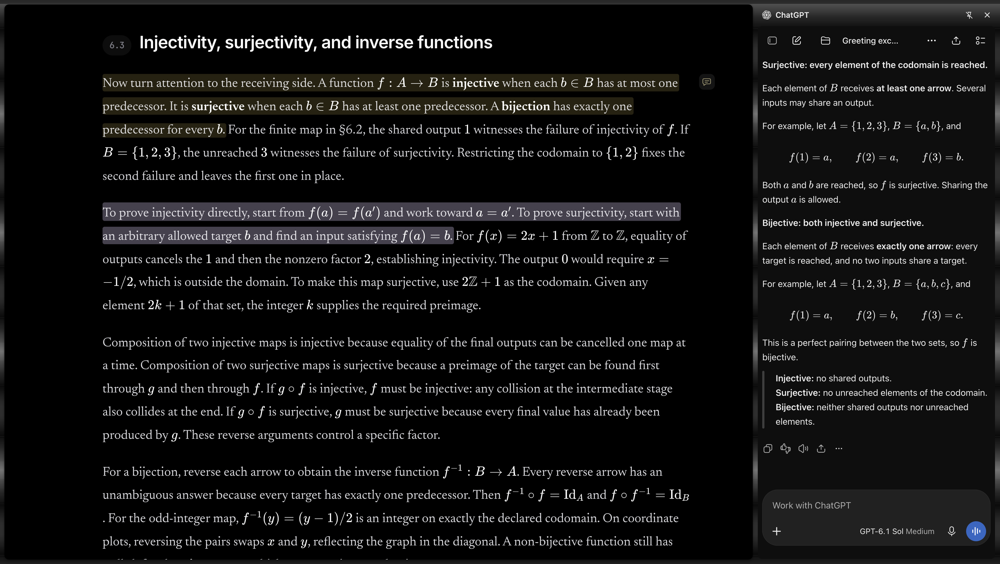

<h1 align="center">Discrete Structures</h1>

<p align="center">An interactive textbook for TUM’s INHN0004 course.</p>

<p align="center"><strong><a href="https://ds.tum.ninja/">Read the textbook ↗</a></strong></p>

## How it teaches

Work through a small example by hand, then see how the formal definition describes what you just did. The chapters use graphs, tables, and worked exercises to show why the results hold.

> In a relation with arrows *a* → *b* → *c*, following exactly two arrows takes you from *a* to *c*. So (*a*, *c*) ∈ *R*², and the Boolean matrix for *R*² has a 1 in row *a*, column *c*. [Explore relations](https://ds.tum.ninja/?page=ch04#sec-4-3).

The animations use Manim Community, a fork of the engine Grant Sanderson created for 3Blue1Brown. [About Manim](https://docs.manim.community/en/stable/faq/installation.html).

Read the textbook and search the Symbol Dictionary without an account. Sign in to save notes, highlights, and your place.

## Study with ChatGPT in the sidebar

Keep the textbook open and launch your ChatGPT browser extension in Chrome’s right sidebar, as shown below. Share the passage you’re reading and ask for a smaller example or a hint for the next step of a proof.



<details>
<summary>See the Manim animation and Symbol Dictionary</summary>


</details>

**I don’t have any past exams, so don't ask for them.**

## Run locally

```sh
pnpm install
pnpm dev
```
