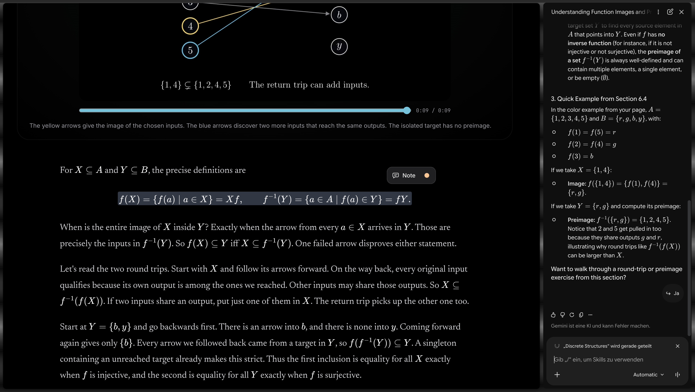
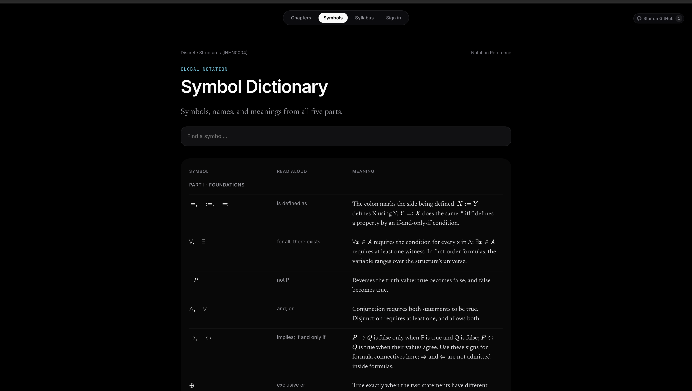

# Discrete Structures (INHN0004)

An interactive textbook for TUM's Discrete Structures course. [Read the textbook](https://ds.tum.ninja/).

The reader includes worked practice and a searchable symbol dictionary. Sign in to save notes, highlights, and reading progress.

## How it teaches

The explanations start with a small example you can work through by hand. Once the idea is clear, they introduce the notation, state the definition precisely, and explain why the result holds. Graphs, tables, and worked problems help connect each step to the next.

**Example from relations.** Take the relation R with the arrows a → b and b → c. Where can you get from a in exactly two steps? Follow the arrows through b to c. In symbols, (a, c) ∈ R². In the Boolean matrix for R², that same fact appears as a 1 in row a, column c. [Explore relations in the textbook](https://ds.tum.ninja/?page=ch04#sec-4-3).

The animations use Manim Community, a fork of the animation engine Grant Sanderson created for 3Blue1Brown. [About Manim](https://docs.manim.community/en/stable/faq/installation.html).

## Studying side by side

On desktop, keep the textbook on the left and your AI chat on the right. Use Chrome split view with ChatGPT, Gemini, or Claude. Where available, Gemini in Chrome and the Claude in Chrome extension also offer side panels. [Chrome split view](https://support.google.com/chrome/answer/16971124) · [Gemini in Chrome](https://support.google.com/chrome/answer/16283624) · [Claude in Chrome](https://support.claude.com/en/articles/12012173-get-started-with-claude-in-chrome)

Share the textbook passage you’re working on and ask for a concrete example or a hint for the next step of a proof.

See the Manim example and Symbol Dictionary

**I don’t have any past exams, so don't ask for them.**

## Run locally

    pnpm install
    pnpm dev
